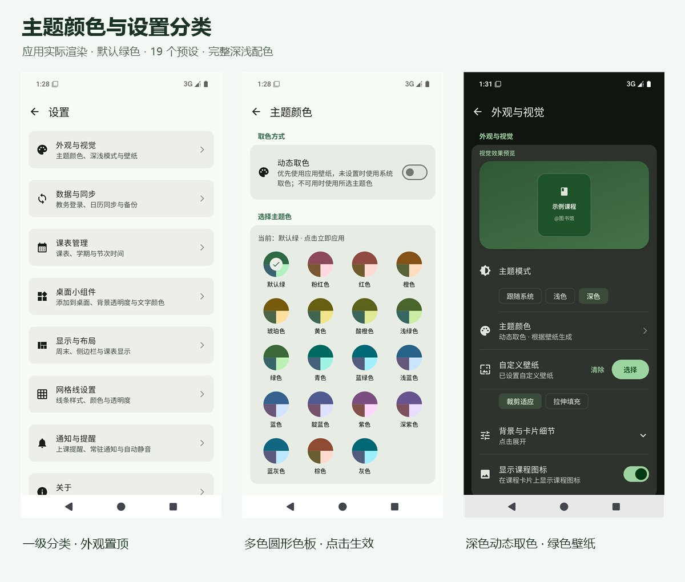

# 主题颜色与设置分类

设置首页仅显示一级分类：「外观与视觉」排第一，其次为「数据与同步」、课表管理、桌面小组件、显示与布局、网格线设置、通知与提醒、关于。点击后显示该类的原有选项，系统返回与左上返回都会回到上一级。

「外观与视觉 → 主题颜色」提供 19 个预设颜色，采用参考 PiliPlus 的多色圆形色板、勾选和即时预览交互。默认绿的种子色为 `#5CB67B`。点击色板立即生效并关闭动态取色；再次打开动态取色时，保留手动选择，关闭后恢复该颜色。

新安装默认绿色且关闭动态取色；升级保留已保存的动态取色开关。未保存或无法识别的主题色回退到默认绿。选择通过原有设置 DataStore 持久化，并随完整设置备份、还原。

动态取色优先使用应用内自定义壁纸，未设置或无法读取时尝试 Android 系统配色，不可用则回退到手动选择的主题色。三种主题模式（跟随系统、浅色、深色）均继续可用。

旧壁纸配色只替换 primary/secondary/tertiary，导致深绿主色和默认紫色的前景、容器混用，深色按钮对比度仅约 1.70。现在壁纸与手动颜色共用完整 Material 色阶生成器（MaterialKolor color utilities 3.0.1），同时生成所有背景、容器、前景与固定色角色。

自动回归覆盖深绿壁纸的深色按钮及容器，以及 19 个预设在深浅两种模式下的九组前景/背景对比度（至少 4.5）。实际设备配色仍取决于壁纸与 ROM，真机需覆盖安装后确认。

