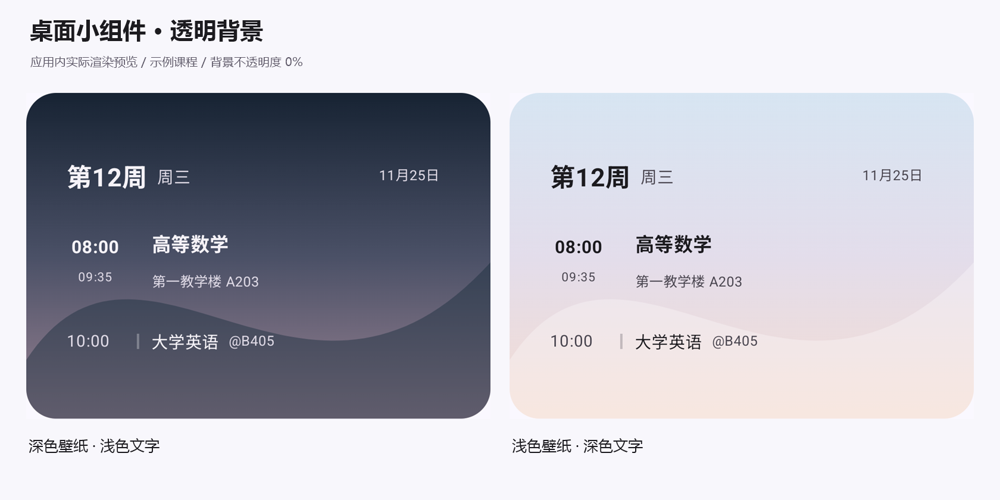

# 桌面小组件与透明背景

## 本次需求

- 在应用内添加「添加桌面小组件」入口，支持桌面时请求系统确认添加。
- 桌面不支持时说明手动添加方法，不把请求成功当作添加完成。
- 背景可从完全透明调到实色；日期和课程卡片跟随透明度，透明时无白色遮罩。
- 提供跟随系统、浅色和深色文字，适配不同明暗壁纸。
- 渲染一版预览供用户查看。预览使用明确标识的示例课程；实际组件显示真实课程。
- 保留已安装用户原有的实色背景，外观设置不改变应用壁纸或课程卡片。

## 使用

从「设置 → 桌面小组件」进入。背景不透明度设为 0% 即为完全透明，深色壁纸建议浅色文字。
预览中的壁纸切换只用于检查对比度，不会修改手机桌面壁纸。
外观保存后刷新所有已添加的小组件，关闭应用后保留设置。

「添加到桌面」调用标准 Android `AppWidgetManager.requestPinAppWidget`，需要用户在系统窗口确认。
桌面拒绝或不支持该接口时，可长按桌面空白处，在小组件列表查找「课程表」。
该入口不保证小米长按应用菜单出现 Widgets，也不提供小米负一页专用卡片。

## 实现

Settings UI → WidgetSettingsViewModel → UpdateWidgetAppearanceUseCase → WidgetAppearanceRepository。
DataStore 持久化独立的 widget 字段，沿用全应用单一 DataStore 实例。
平台添加动作由 app 层处理，settings 不依赖 widget feature，ViewModel 不持有 Context。
Compose 预览与 Glance 使用 core/ui 共享配色；Glance 在非实色模式禁用列表上下白色渐隐遮罩。

## 验证（1.0.5.8-jyu）

- JVM：旧安装默认值、Repository 重建后的设置读取、无关设置保留、越界值与未知枚举回退；保存完成后刷新，保存失败不刷新。
- 模拟器：进入设置、调整透明度和文字、预览深浅壁纸、系统添加确认、桌面实色与透明效果。
- API 35 模拟器覆盖安装 release 后，完全透明与浅色文字设置仍保留，已添加实例可更新为实色并恢复透明。
- 全量 504 项 JVM 测试通过；release 构建通过；Lint 0 错误、29 项已有警告。
- 实机限制：小米桌面和负一页的厂商行为需用户在真机确认。

